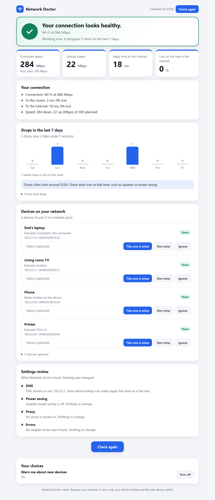
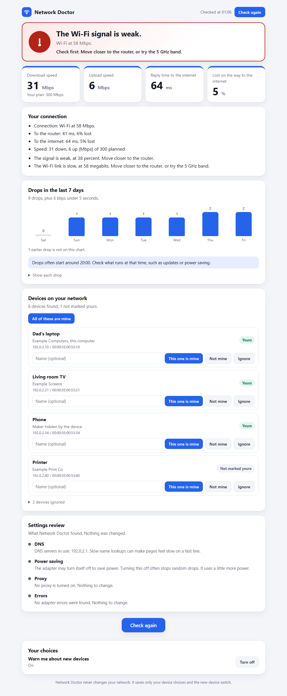

# Network Doctor

Network Doctor checks your internet connection, wired or Wi-Fi. It tells you in plain words what is wrong and what to check first. It is one small program file for Windows, Mac or Linux, written in Go, free and open source under the MIT license.

Designed and directed by Rafiq. Built with Claude.

It has one default part and two add-ons:

- **Check on demand** (default, always included): run a check any time. Works on Windows, Mac and Linux.
- **Weekly check** (add-on): saves your speed once a week.
- **Alerts** (add-on): warns you when the connection drops, when the speed stays low (if you set your plan speed), or when a new device appears.

Windows, Mac and Linux each have a setup that installs it and offers both add-ons. It makes a Network Doctor icon: press it, and a page opens in your web browser, runs the check and shows the answer.

Windows is tried on real computers. The Mac and Linux setups and fixes are proved on GitHub's clean machines and with simulated commands, not yet on real desktops.



*Example data. These numbers are an example, not a real check.*



*Example data. These numbers are an example, not a real check.*

The page looks the same on Mac and Linux as on Windows. The web page only looks, apart from saving your choices about your devices, and has no fix buttons; fixes are run by command.

## What this project demonstrates

| Skill | Evidence in this project |
|---|---|
| **Security by design** | Checks only look. A fix changes something only when you type it and say yes to that one fix, after a before-and-after view, with a log and an undo where one is possible. It never touches drivers or security protections, never asks for a router password, and refuses to reset the adapter or renew the address while the connection works. |
| **No data leaves quietly** | No tracking and no reports. Every request it makes is listed in the guide, with the server it goes to. A leak test in the repository scans the files for private data. |
| **Automation** | The weekly check runs on its own through a Windows scheduled task, a Mac LaunchAgent, or a Linux user systemd timer (a crontab line where there is none), and the alerts helper starts at log-in and is started again if it stops. `netdoctor watch` raises an alert when the connection drops, and `netdoctor check --json` gives the full result to scripts and other tools. |
| **Engineering discipline** | Written [requirements](docs/requirements.md), [test cases](docs/test-cases.md) and [test results](docs/test-results.md); 501 Go test functions; about 13,000 lines of program and 16,000 lines of tests (non-blank Go lines); on every change GitHub checks formatting, runs go vet and the tests on Windows and Linux, builds the Windows installer and installs and removes every choice on a clean machine. Mac is proved by a separate run started by hand; neither Mac nor Linux is yet proved on a real desktop. |
| **One codebase, every system** | Written in Go. One small program file each for Windows, Mac, Linux and ARM servers. |
| **Directing AI to build** | Designed and directed by Rafiq. Built with Claude, under written rules, a test for each requirement and a separate reviewer. |

## What it will never do

- **Checks only look.** A check never changes anything. Apart from its own settings and the weekly task you ask for, only the `fix` command changes anything, and only when you type it and say yes to that one fix.
- **It sends none of your data away.** No tracking and no reports. Your name, your devices, your results and your settings stay on your computer. The main requests it makes are listed below.
- **It never asks for a router password.** If a check ever needed one, you would type it yourself, and it would not be saved.

## What it tells you

- Whether the trouble is this computer, the cable or signal, your router, your provider, or a Wi-Fi sign-in page (hotel, airport, cafe).
- How fast your line is, how long replies take, and how much data gets lost.
- Weak or slow Wi-Fi, a computer clock more than 5 minutes off, and a change in the country your internet leaves from.
- How many times the connection dropped in the last week, and which devices are on your network.
- A weekly record of your speed, and a draft note you can send your provider (it is never sent for you).

The [one-page guide](docs/GUIDE.md) has every check, with where each result shows.

## Fixes (optional, always your yes)

There are six fixes. Each is shown before and after, written to a log, and can be undone where an undo is possible. Five of them, `name-cache`, `proxy`, `public-dns`, `renew-address` and `reset-adapter`, work on Windows, Mac and Linux (Mac and Linux proved with simulated commands, not yet on real desktops); on a Mac or Linux, a fix whose system tool is missing is refused and changes nothing. `power-saving` is always refused, because turning it off could drop the connection you are using; you get the steps instead. See them with `netdoctor fix list`. The [guide](docs/GUIDE.md) explains each one.

## What goes over the internet

- **Speed test:** test data to and from `speed.cloudflare.com`, and a second Cloudflare test only when the first number looks wrong.
- **Country lookup:** one small request to `speed.cloudflare.com/cdn-cgi/trace` on each online check. Only the two-letter country code is kept.
- **Sign-in test:** one plain request to the system's own test address (on Linux always Ubuntu's connectivity address), with no cookies and no redirects followed.
- **Device names:** a name lookup for each device's address, sent to your computer's own name server (with the `public-dns` fix on, that is Cloudflare's).
- **Alerts helper:** a light Cloudflare speed test on its first round and on every 30th round after that.
- **Reachability:** a ping to `1.1.1.1` and a lookup of `example.com`.
- **Ookla's tool:** only if you add it yourself, or tick both boxes in setup, which downloads it from `install.speedtest.net`, under Ookla's own terms.

Like any web request, each server sees your public internet address. Network Doctor never sends your name, your devices or your settings. The [guide](docs/GUIDE.md) lists every request in full.

## Get it

Network Doctor is made for people who have never opened a terminal. Building it from this source is for someone comfortable with one, so no ready-made download is offered: build it yourself from this source (see "Build it yourself" below). A build from source says 0.4.0. The scripts in `scripts/` make the plain files (`package.ps1`) and the setup files for Windows (`build-installer.ps1`), Mac (`package-mac.sh`, on a Mac) and Linux (`package-linux.sh`). The Windows setup needs Inno Setup 6, and the Mac setup must be built on a Mac.

The files you build are not signed, and the Mac file is not notarized by Apple. A computer with a strict rule about which apps may run may refuse to run them. We do not ask you to switch that protection off.

## Install it (Mac)

Open the setup zip you built and double-click Network Doctor Setup. The first time, the Mac blocks it, because Apple has not checked it: try to open it once, then open System Settings, then Privacy and Security, press "Open Anyway" and enter your Mac password. macOS 15 (Sequoia) and newer have no right-click way. A page opens in your web browser with the three parts and the optional Ookla step. It never asks for an administrator password. The finish screen says what is on and where your results are saved (`~/Library/Application Support/NetworkDoctor`), and its "Open the guide" button shows the guide. To remove it, open Uninstall Network Doctor in your Applications folder; it takes away everything, your saved results and settings too, so a new install starts fresh. The [guide](docs/GUIDE.md) has every step, and the silent switches for IT.

## Install it (Linux)

Extract the setup `.tar.gz` and double-click Install Network Doctor. If your desktop asks first, right-click it and choose "Allow Launching". A page opens in your web browser with the three parts and the optional Ookla step. It never asks for an administrator password. The finish screen says what is on and where your results are saved (`~/.config/NetworkDoctor`), and its "Open the guide" button shows the guide. To remove it, open Uninstall Network Doctor in your applications menu; it takes away everything, your saved results and settings too, so a new install starts fresh. The [guide](docs/GUIDE.md) has every step, and the silent switches for IT.

## Use it

If you installed it with the setup you built, press the Network Doctor icon: a page opens in your web browser and runs the check.

To run the plain program file without installing it, open a terminal in the folder with the file and type (in Windows PowerShell, put `.\` first: `.\netdoctor check`):

```
netdoctor check
```

It takes under a minute. The [one-page guide](docs/GUIDE.md) covers a private page you can open on your phone, fixes, a weekly check, and alerts when the connection drops.

## Build it yourself

You need [Go](https://go.dev/dl/) 1.27.4 or newer (the version `go.mod` asks for).

```
go test ./...
go build ./cmd/netdoctor
```

## How it is made

- What it must do: [requirements](docs/requirements.md). How each part is checked: [test cases](docs/test-cases.md), with [results](docs/test-results.md).
- What changed: [changelog](CHANGELOG.md).
- `ND-nn` in those documents is a requirement number.

## About the builder

I'm Rafiq. I design and direct software and build it with AI. Network Doctor is a small, finished tool built with the same discipline as my larger projects: written requirements, a test for each, and nothing called done until it is shown to work. My other projects are on [my profile](https://github.com/rafiqkmateen). I am looking for AI implementation, AI security and AI automation roles.

- **Contact:** [rkmaerial@gmail.com](mailto:rkmaerial@gmail.com)

## License

MIT. See [LICENSE](LICENSE). One outside library, `rsc.io/qr`, has its own notice in [THIRD-PARTY-NOTICES.txt](THIRD-PARTY-NOTICES.txt).

---

*Page owner: Rafiq. Page version 0.8.1. What changed is in the [changelog](CHANGELOG.md).*
