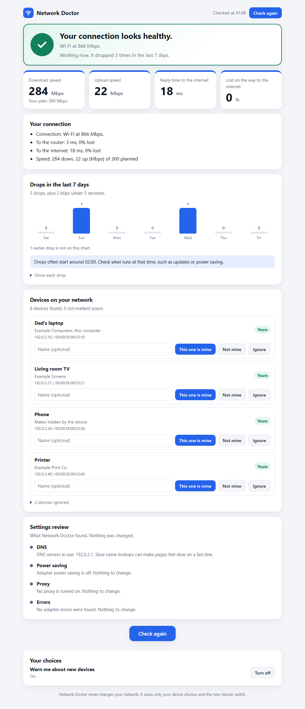

# Network Doctor: one-page guide

Showcase note: this copy is published without the code, which is private, and without downloads. Mentions of releases, source folders, the front page and the change list describe the private project. Purpose: how to use Network Doctor, in plain words, for anyone.
Owner: Rafiq. Version 0.7.2 (0.7.2: the example pictures redone for the new page, with the devices list and the newer-page notice added, 2026-11-20; 0.7.1: the page follows the Windows clock setting, "This one is mine", "Your choices", 2026-11-19; 0.7.0: the icon opens the check as a page in the web browser, `open`, marking devices on the page and the new-device switch, 2026-11-19; 0.6.1: the check command is written with a leading dot and backslash so PowerShell runs it, 2026-11-19; 0.6.0: the latest release is v0.3.0, 2026-11-19; 0.5.0: Windows, Mac and Linux with the two add-ons, the new checks and fixes, what goes over the internet, example pictures, 2026-11-18; 0.4.0: fixes, private phone page; 0.3.2: the Start it section points to the installer; 0.3.1: check time; 0.3.0: setup helper, share command, alerts file, Mac and Linux; 0.2.0: install section; 0.1.0: first guide).

## What it does

Network Doctor looks at your internet connection, wired or Wi-Fi. It tells you in plain words what is wrong and what to check first. A check only looks. Apart from its own settings and the weekly task you ask for, only the `fix` commands change anything (see "Fix a problem" below), and only when you type the command and say yes.

## Which version has what

This guide describes the newest code. It is shown here as part of the showcase: the code is private and no download is offered, so read it to see what the tool does.

## Windows, Mac and Linux

Network Doctor is one small file for Windows, Mac or Linux. It has one default part and two add-ons:

- **Check on demand.** The default, always included. You run a check any time you want one. It works on Windows, Mac and Linux.
- **Weekly check.** An add-on that saves your speed once a week.
- **Alerts.** An add-on that warns you when the connection drops, when the speed stays low (if you set your plan speed), or when a new device appears.

On Windows, the setup file offers both add-ons (see "Install it (Windows)" below). There is no setup file for Mac or Linux. There you use the plain file and start the add-ons yourself (see "Check every week" and "Get warned").

What works everywhere: the check, the web page, the phone page, the weekly record (`netdoctor weekly`), `watch` with alerts in the window or a file, and the `name-cache` fix.

What works only on Windows: the setup file, the built-in weekly schedule, alerts as a pop-up on the screen, and the fixes `proxy`, `power-saving`, `public-dns`, `renew-address` and `reset-adapter`. On Mac and Linux those fixes are refused, and nothing changes.

## Start it

The plain file needs no install. Open a terminal in the folder with `netdoctor.exe` (on Mac and Linux, `netdoctor`) and type:

```
.\netdoctor check
```

On Mac and Linux, type `./netdoctor check`. The `.\` (or `./`) tells the terminal to run the program in this folder; PowerShell, the default terminal in Windows 11, needs it.

It takes under a minute. It prints the answer first, then the numbers.

If you installed it with the Windows setup file, there is nothing to type: press the Network Doctor icon on your desktop or in the Start menu. A page opens in your web browser, runs the check and shows the answer. Close the browser tab when you are done; Network Doctor quits by itself a few minutes later. If no browser can be opened, a small box shows the address to open; press OK when you are done. Times on the page follow your Windows clock setting (12- or 24-hour). `netdoctor open` does the same on any system.

The first time you type just `netdoctor` in a window, a short helper starts. You can run it again any time with `netdoctor setup`. It asks for your plan speed, your name and which devices on your network are yours. It asks whether to turn on the weekly check, whether to save alerts in a file, and whether to show the page on your phone. Press Enter to skip any question. On a copy installed with the Alerts add-on, it asks instead whether to keep alerts on the screen and in a file, and there Enter means yes. Setup never starts `watch`. On Mac and Linux, a yes to the weekly question only prints a reminder to use cron or a systemd timer.

## What you see

- **Answer**: whether the problem is this computer, the cable or signal, the router, your provider, or a sign-in page. When there is a problem, **Check first** says what to look at.
- **Drops**: how many times the connection dropped in the last 7 days, and when.
- **Line use right now**: what is using the line. It is an estimate, and it never stops anything.
- **Devices**: everything on your network. Mark the ones you know on the page (see "See it on a screen or a phone" below) or with `netdoctor known add MAC NAME`.
- **Settings review**: six things that often cause trouble, each with what changing it would do.

## What the check looks for

- **Sign-in page.** Hotel, airport and cafe Wi-Fi often show a sign-in page before the internet works. The check asks the system's own test address for a page. If a different page comes back, the Answer says the Wi-Fi has a sign-in page, and Check first says to open a web browser and look for it.
- **Clock.** The check reads the time only from the answer to the sign-in test. If your computer's clock is more than 5 minutes off, it says so, because websites and sign-ins can fail when the clock is wrong. It never changes the clock.
- **Where your internet leaves from.** The check names the country your internet seems to come from, like "Your internet leaves from the United States." It remembers it. If the country changes, a note names both places for 14 days and says a VPN or a change at your provider can cause it. A VPN on your router cannot be seen from the computer.
- **A second speed test.** Sometimes the download looks far too low. That means under one fifth of the upload (when the upload is at least 20 megabits), or under one fifth of last week's download. Then the check runs a second speed test, always with Cloudflare's test and never with Ookla's tool. It keeps both results. The speed it shows uses the higher download, so one odd number is never the answer.
- **Weak Wi-Fi.** The signal is called weak at -75 dBm or lower (50 percent on Windows' scale). The link is called slow under 20 megabits. A number Windows did not share is never called weak or slow.
- **Hidden Wi-Fi details.** When Windows does not share the Wi-Fi details, the check says so in plain words instead of guessing.
- **Other languages.** On a Windows set to another language, the check still reads the Wi-Fi signal, band, channel and link speed.
- **Wi-Fi with no address.** When the Wi-Fi is joined but got no address from the router, the check says so and tells you to restart the router. This works on Windows, on a Mac and on Linux.

Where each one shows:

- The sign-in page shows in the Answer, in the terminal and on the web page.
- Where your internet leaves from and hidden Wi-Fi details print below the numbers in the terminal. They are also in `netdoctor check --json`. They are not on the web page.
- Some results show only in `netdoctor check --json`: the clock note, both speed results (`speed_recheck`), the fixes that fit (`fix_offers`) and the fixes you can put back (`undos`).

## See it on a screen or a phone

```
netdoctor serve
```

Open `http://127.0.0.1:8765/` on the same computer. The check starts by itself; press "Check again" for another. To use https there too, type `netdoctor serve --https`. `netdoctor open` (what the icon runs) picks a free address by itself, opens your browser to it and quits when the page is closed.

The web page only looks at your connection and never changes your network; the only things it saves are which devices you say are yours and whether to warn you about new ones. It has no fix buttons. Fixes are typed in the terminal (see "Fix a problem" below).

**Your devices.** On the page on this computer, each device has three buttons: "This one is mine" (with an optional name, up to 40 characters), "Not mine" and "Ignore". "All of these are mine" marks every device you have not decided on yet. Your choices go in the same list as `netdoctor known add`; pressing again changes the choice, it never adds a device twice. Ignored devices are never reported as new; the page shows how many there are and a "Bring back" button. A device you mark "Not mine" stays at the top of the list. Network Doctor cannot remove it: changing the Wi-Fi password on your router takes off anyone who does not know the new password. If your router's address is a private one, the page offers "Open my router's page". Network Doctor never logs in to your router; you type its password yourself. The buttons show only on the page Network Doctor opens on its own computer, not on a phone.

**Warn me about new devices.** This switch is under "Your choices" at the bottom of the page and is on unless you turn it off. Turning it off takes one more press, because anyone could then join your network without you being told. While it is off, the page shows no warnings about strangers and alerts report no new devices. `netdoctor config show` shows it as `warn_new_devices`.



*Example data. These numbers are an example, not a real check.*


*Example data. These numbers are an example, not a real check.*


*Example data. These devices and numbers are an example, not a real check.*


*Example data. This notice is an example from a test page, not a real check.*

The page looks the same on Mac and Linux as on Windows.

To open the page on your phone:

1. Type `netdoctor share`. It starts the page for your own network only.
2. It prints an address and a code. The address starts with `https`, because the page is private.
3. Make sure the phone is on the same Wi-Fi as the computer.
4. Point the phone camera at the code, or type the address.
5. The first time, the phone says the page is not secure. That is expected: the lock was made on your computer, and the phone has not seen it before. Press Advanced, then Continue. It asks only once.
6. When the phone opens the page, the window says so.

If nothing happens after a minute, the window lists what to try: press Allow if Windows asks, avoid a guest network, and turn off a VPN. For a plain address without the lock, type `netdoctor share --http`. On a light screen, type `netdoctor share --light` so the code is drawn dark on light.

Network Doctor never changes your firewall. Windows may ask once whether to allow it. That choice is yours.

## Fix a problem (optional)

A check tells you what is wrong. If you want help fixing it, type a `fix` command in the terminal. Nothing runs by itself, and nothing is in the weekly check or alerts.

```
netdoctor fix list
netdoctor fix apply proxy
netdoctor fix apply proxy --yes
netdoctor fix undo proxy
```

- `fix list` shows each fix and its setting right now.
- `fix apply NAME` shows the setting now and what it would become, and changes nothing.
- Add `--yes` to make that one fix. It writes a line to `fix-log.txt`. `proxy` and `public-dns` also save the old value, so you can undo them.
- `fix undo NAME` puts the old value back. If the setting was changed since the fix, it refuses and changes nothing.
- Add `--json` to any of these to get one line another program can read.

The fixes:

- `name-cache` clears the saved list of website addresses. It works on Windows, Mac and Linux. On a Mac it runs `dscacheutil -flushcache`. On Linux it runs `resolvectl flush-caches`, so it needs systemd-resolved.
- `proxy` turns off a web proxy.
- `power-saving`: Network Doctor never turns power saving off itself. Turning it off could drop the connection you are using, so this fix is always refused, and you get the steps for Device Manager instead. Some drivers also hide the setting.
- `public-dns` changes who turns website names into addresses for the adapter in use. It switches to Cloudflare (1.1.1.1 and 1.0.0.1), a company that is not your provider. It is offered only when websites cannot be looked up but the internet answers. `fix undo public-dns` puts your old settings back.
- `renew-address` asks the router for a new address. It is offered only when the adapter in use has no usable address. It has no undo.
- `reset-adapter` turns the network adapter off and on. It is offered only when the connection is already dead. It has no undo.

`public-dns`, `renew-address` and `reset-adapter` work only on Windows, and Windows asks for permission first. When you say yes to `renew-address` or `reset-adapter`, Network Doctor looks again: if the trouble is gone, it changes nothing. After each of the three, it reads the result back and tells you if the fix failed. It never changes drivers or security, and it never does anything that could cut off a connection that works.

**Machines nobody sits at.** `NETDOCTOR_UNATTENDED` is an environment variable. If it has any value at all, even 0 or off, fixes are off. They stay off until you type `netdoctor fix enable-here` on that machine. Network Doctor does not find out by itself that a machine is a server.

To set an environment variable: on Windows, type `setx NAME value` and open a new window; on Mac and Linux, type `export NAME=value` in the window you use.

## Check every week

```
netdoctor config plan 300        (your plan speed, in Mbps)
netdoctor config name "Your Name"
netdoctor schedule enable        (Monday at 0900 by default)
```

`schedule enable` works on Windows. It makes a Windows scheduled task. On Mac and Linux, use cron (or a systemd timer on Linux) to run `netdoctor weekly` once a week.

Each week it adds a line to `weekly.csv`, which Excel opens. If your download stays under half of your plan for three weeks in a row, it writes a draft complaint email to `complaint-draft.txt`. It never sends it. You read it, change it and send it yourself.

## Get warned

```
netdoctor watch
```

`watch` checks the link once a round. A round is 60 seconds unless you add `--interval SECONDS`. It warns you when the link drops. On its first round and every 30th round after, about every 30 minutes at the default, it also runs a light Cloudflare speed test and looks for new devices. Devices you marked "Ignore" on the page are never reported, and no new device is reported while the page's "Warn me about new devices" switch is off.

The slow-speed warning needs your plan speed (`netdoctor config plan N`). It comes when three light tests in a row are under half of your plan. At the default, that is about an hour after the first slow test.

Messages show in the window by default. `netdoctor config quiet 22 6` keeps it quiet from 2200 to 0600.

If you picked the Alerts add-on in the Windows setup file and have not chosen places yourself, alerts go to the window, to the file `alerts.log` and to the screen. `netdoctor setup` asks once whether to keep this, and Enter means yes.

To save alerts in a file, type `netdoctor config alerts-file on`. Type `off` to stop. It does not change where else alerts go. `netdoctor config sinks console,file,screen` sets all the places at once, with a Windows pop-up as `screen`.

The file is `alerts.log`, in the same folder as `weekly.csv`. Each alert is one line with three parts split by a tab: the time (like `2026-11-11T20:00:00Z`), the kind (`drop`, `slow` or `new_device`), and the message. Another program can read it line by line.

**Trusted devices from another program.** Another program may keep a list of devices you trust. Type `netdoctor config known-from PATH` to use that list too. The file must be a JSON object whose keys are the devices' hardware addresses. A JSON list does not work. It is off unless you set it, so every new device is reported by default. `config known-from off` stops it. `watch` reads the list again on each of its full rounds.

## What goes over the internet

Your own data stays on your computer. Your name, your devices, your results and your settings are never sent by Network Doctor. There is no tracking and no report. Network Doctor makes these small requests:

- **Speed test**: test data down from and up to `speed.cloudflare.com`.
- **Second speed test**: the same Cloudflare test again, only when the first number looks wrong.
- **Country lookup**: one small request to `speed.cloudflare.com/cdn-cgi/trace` on each check that is online. Cloudflare answers with a few lines about the connection. Network Doctor keeps only the two-letter country code and saves it on your computer.
- **Sign-in test**: one plain web request on each check to the system's own test address: `www.msftconnecttest.com` on Windows, `captive.apple.com` on a Mac, and `connectivity-check.ubuntu.com` on Linux. Linux always uses Ubuntu's sign-in test address, whatever kind of Linux it is. It keeps no cookies, follows no redirects, and gives only "Network Doctor" as its name.
- **Device names**: a name lookup for each device's address on your network. It goes to your computer's own name server. That is usually your router, or Cloudflare after the `public-dns` fix.
- **Alerts helper**: `watch`, which the Alerts add-on runs all the time, runs the light Cloudflare speed test on its first round and every 30th round after, about every 30 minutes at the default of one round every 60 seconds.
- **Reachability**: a ping to `1.1.1.1` and a lookup of the name `example.com`.
- **Ookla's tool**: only if you added it. Network Doctor uses it when it is in an `ookla` folder beside the program, named by the `NETDOCTOR_OOKLA` environment variable, or found on the PATH. If you tick both Ookla boxes, the Windows setup downloads it from `install.speedtest.net` and runs it once to accept Ookla's license. It talks to Ookla's servers and reports its test to Ookla, under Ookla's own privacy terms.

Like any web request, each server sees your public internet address.

After a speed test, the next check waits before it tests again. It waits 10 minutes after a Cloudflare test. It waits 2 minutes if the number it kept came from Ookla's tool. So when Ookla's number is kept, the second speed test can run again after 2 minutes, sooner than the 10-minute Cloudflare hold. `watch` ignores both waits.

## Install it (Windows)

If you were given the Network Doctor setup file (`NetworkDoctor-Setup-` and a version number), double-click it. Windows asks for permission once. Then pick the parts you want:

- **Check on demand.** Always included. You run a check any time you want one.
- **Weekly check.** Once a week, Monday at 0900, it saves your speed to a file. Your data never leaves your computer. The speed test and the small requests in "What goes over the internet" do go out.
- **Alerts.** A small helper starts when you log on and runs all the time. Alerts are kept in a file and shown on the screen when your connection drops, stays slow, or a new device appears. You can turn off the pop-ups and the file with `netdoctor setup`. Your data never leaves your computer. The light speed test and the small requests in "What goes over the internet" do go out.

The program goes in `C:\Program Files\Network Doctor`. Your results go in `C:\ProgramData\NetworkDoctor`.

**Run the setup again to repair.** It puts back the parts you chose and removes the ones you did not. A small file, `choices.json`, in the program folder records your choices.

**Better speed numbers (optional).** The setup can offer Ookla's own Speedtest tool, the one behind speedtest.net. It is not part of Network Doctor. Ookla allows it for your own personal use on a computer you own. The setup asks first, shows links to Ookla's license, and only downloads it if you tick that you accept it. You can also install it yourself from Ookla's page and put `speedtest.exe` in an `ookla` folder inside the program folder. Ookla's tool reports its tests to Ookla. Without it, Network Doctor uses its own lighter test. If you ask for a speed test too soon, the check uses the last reading and says when to come back.

**For IT, with no window.** Run the setup file with `/VERYSILENT /SUPPRESSMSGBOXES`. Add `/COMPONENTS="scheduled,proactive"` for both add-ons, or just one of the two names. Leave `/COMPONENTS` out to install only the check on demand.

**To remove it.** Open Windows Settings, then Apps, then Installed apps, find Network Doctor and press Uninstall. It asks if you want to keep your saved results. It removes the weekly task and the alerts helper too. IT can run `"C:\Program Files\Network Doctor\unins000.exe" /VERYSILENT /SUPPRESSMSGBOXES`. That keeps your results. Add `/DELETERESULTS=1` to delete them.

## If something goes wrong

- **It says it could not read something**: a few facts need administrator rights. On Linux, that is the drop history, which comes from the system log. On a Mac, that is the programs other people are running. Then it says so and does not guess.
- **A number looks wrong**: run `netdoctor check --json` and keep the output. It has every number.
- **Exit codes** for `check`: 0 healthy, 10 this computer, 11 cable or signal, 12 router, 13 provider, 14 sign-in page. Code 2 means a bad command, or that the settings file could not be read, the page could not start, or the weekly record could not be saved. `weekly` gives 0 when it is done.

## Builder box

Where files live:

- A copy installed by setup on Windows: `C:\ProgramData\NetworkDoctor`.
- The plain file on Windows: `%AppData%\NetworkDoctor`.
- The plain file on a Mac: `~/Library/Application Support/NetworkDoctor`.
- The plain file on Linux: `~/.config/NetworkDoctor`, or `NetworkDoctor` inside the `XDG_CONFIG_HOME` folder when that is set.
- Anywhere: the folder named by the `NETDOCTOR_DIR` environment variable, when it is set.

Written in Go; the code is private. The only requests to outside servers are the ones in "What goes over the internet" above.
