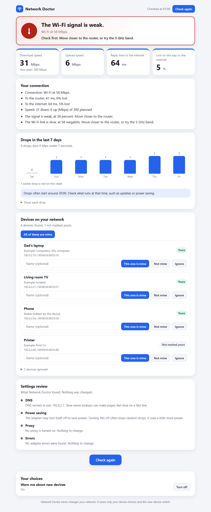
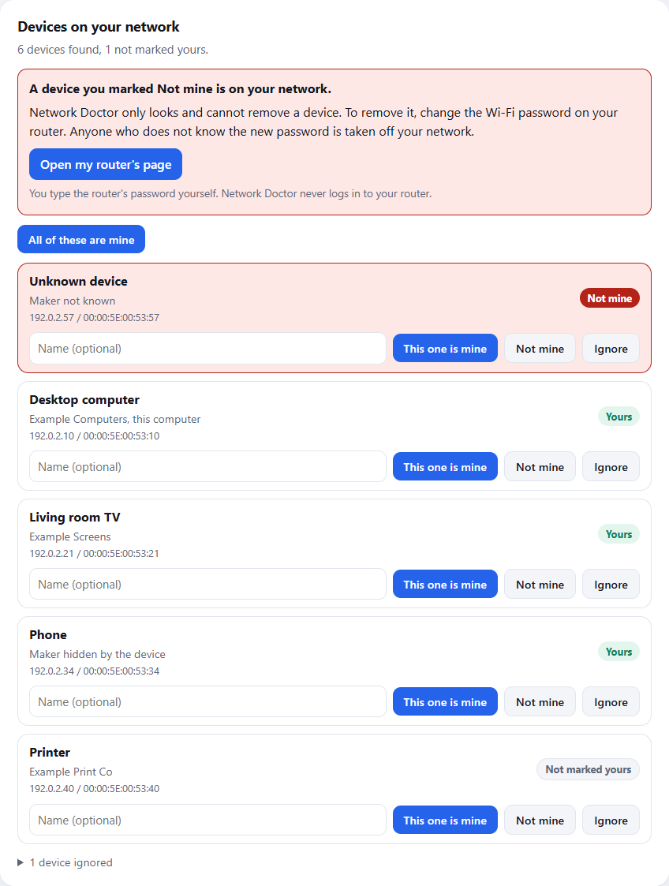

# Network Doctor: one-page guide

Purpose: how to use Network Doctor, in plain words, for anyone.
Owner: Rafiq. Version 0.8.8. The history of each version is in CHANGELOG.md.

## What it does

Network Doctor looks at your internet connection, wired or Wi-Fi. It tells you in plain words what is wrong and what to check first. A check only looks. Apart from its own settings and the parts setup installs and you ask for, only the `fix` commands change anything (see "Fix a problem" below), and only when you run the command and say yes.

## Which version has what

This guide describes the newest code. No ready-made download is offered: build it yourself from the source (see "Build it yourself" on the front page). A build from source says 0.4.0. Versions 0.1.0 to 0.3.0 were released earlier and are no longer offered.

**Not yet tried on a real machine.** The Mac and Linux setups were tried on clean test machines that have no screen and no person at them. So four things are not yet proven: the weekly check on Linux when the computer's own timer or your crontab runs it; the "Allow Launching" step on a real Linux desktop; whether a Mac asks once for permission to control Finder (setup uses Finder to put the icon on your Desktop, so press OK if it asks); and whether a Mac runs a missed weekly check when it wakes. The fixes on Mac and Linux, the box that shows the address when no browser opens, and the 12- or 24-hour clock setting were tested with pretend commands and sample answers, not on a real Mac or Linux computer.

## Windows, Mac and Linux

Network Doctor is one small file for Windows, Mac or Linux. It has one default part and two add-ons:

- **Check on demand.** The default, always included. You run a check any time you want one. It works on Windows, Mac and Linux.
- **Weekly check.** An add-on that saves your speed once a week.
- **Alerts.** An add-on that warns you when the connection drops, when the speed stays low (if you set your plan speed), or when a new device appears.

Windows, Mac and Linux each have a setup that offers both add-ons and makes a Network Doctor icon. On Windows, double-click the setup file. On a Mac, open Network Doctor Setup. On Linux, open Install Network Doctor. See "Install it (Windows)", "Install it (Mac)" and "Install it (Linux)" below. You can also use the plain file with no install and start the add-ons yourself (see "Check every week" and "Get warned").

What works on all three: the setup, the icon, the check, the web page, the phone page, the weekly check and its schedule, `watch` with alerts in the window, in a file or on the screen, and the fixes `name-cache`, `proxy`, `public-dns`, `renew-address` and `reset-adapter`. On a Mac or Linux, a fix whose system tool is missing is refused, and nothing changes. The `power-saving` fix is always refused, on every system.

## Start it

The plain file needs no install. Open a terminal in the folder with `netdoctor.exe` (on Mac and Linux, `netdoctor`) and type:

```
.\netdoctor check
```

On Mac and Linux, type `./netdoctor check`. The `.\` (or `./`) tells the terminal to run the program in this folder; PowerShell, the default terminal in Windows 11, needs it.

It takes under a minute. It prints the answer first, then the numbers.

If you installed it with a setup, there is nothing to type: press the Network Doctor icon. On Windows it is on your desktop and in the Start menu, on a Mac on your Desktop and in your Applications folder, and on Linux on your Desktop and in your applications menu. A page opens in your web browser, runs the check and shows the answer. Close the browser tab when you are done; Network Doctor quits by itself a few minutes later. If no browser can be opened, a small box shows the address to open; press OK when you are done. Times on the page follow your computer's clock setting (12- or 24-hour).

`netdoctor open` opens the same page, on any system.

The first time you type just `netdoctor` in a window, a short helper starts. You can run it again any time with `netdoctor setup`. It asks for your plan speed, your name and which devices on your network are yours. It asks whether to turn on the weekly check, whether to save alerts in a file, and whether to show the page on your phone. Press Enter to skip any question. On a copy installed with the Alerts add-on, it asks instead whether to keep alerts on the screen and in a file, and there Enter means yes. Setup never starts `watch`.

## What you see

- **Answer**: whether the problem is this computer, the cable or signal, the router, your provider, or a sign-in page. When there is a problem, **Check first** says what to look at.
- **Drops**: how many times the connection dropped in the last 7 days, and when.
- **Line use right now**: what is using the line. It is an estimate, and it never stops anything.
- **Devices**: everything on your network. Mark the ones you know on the page (see "See it on a screen or a phone" below) or with `netdoctor known add MAC NAME`.
- **Settings review**: six things that often cause trouble, each with what changing it would do.

## What the check looks for

- **Sign-in page.** Hotel, airport and cafe Wi-Fi often show a sign-in page before the internet works. The check asks the system's own test address for a page. If a different page comes back, the Answer says the Wi-Fi has a sign-in page, and Check first says to open a web browser and look for it.
- **Clock.** The check reads the time only from the answer to the sign-in test. If your computer's clock is more than 5 minutes off, it says so, because websites and sign-ins can fail when the clock is wrong. It never changes the clock.
- **Where your internet leaves from.** The check names the country your internet seems to come from, like "Your internet leaves from the United States." It remembers it. If the country changes, a note names both places for 14 days and says a VPN or a change at your provider can cause it. A VPN on your router cannot be seen from the computer.
- **A second speed test.** Sometimes the download looks far too low. That means under one fifth of the upload (when the upload is at least 20 megabits), or under one fifth of last week's download. Then the check runs a second speed test, always with Cloudflare's test and never with Ookla's tool. It keeps both results. The speed it shows uses the higher download, so one odd number is never the answer.
- **Weak Wi-Fi.** The signal is called weak at -75 dBm or lower (50 percent on Windows' scale). The link is called slow under 20 megabits. A number Windows did not share is never called weak or slow.
- **Hidden Wi-Fi details.** When Windows does not share the Wi-Fi details, the check says so in plain words instead of guessing.
- **Other languages.** On a Windows set to another language, the check still reads the Wi-Fi signal, band, channel and link speed.
- **Wi-Fi with no address.** When the Wi-Fi is joined but got no address from the router, the check says so and tells you to restart the router. This works on Windows, on a Mac and on Linux.

Where each one shows:

- The sign-in page shows in the Answer, in the terminal and on the web page.
- Where your internet leaves from and hidden Wi-Fi details print below the numbers in the terminal. They are also in `netdoctor check --json`. They are not on the web page.
- Some results show only in `netdoctor check --json`: the clock note, both speed results (`speed_recheck`), the fixes that fit (`fix_offers`) and the fixes you can put back (`undos`).

## See it on a screen or a phone

```
netdoctor serve
```

Open `http://127.0.0.1:8765/` on the same computer. The check starts by itself; press "Check again" for another. To use https there too, type `netdoctor serve --https`. `netdoctor open` (what the icon runs) picks a free address by itself, opens your browser to it and quits when the page is closed.

The web page only looks at your connection and never changes your network; the only things it saves are which devices you say are yours and whether to warn you about new ones. It has no fix buttons on any system. Fixes are run by command (see "Fix a problem" below), never from the icon or the page.

**Your devices.** On the page on this computer, each device has three buttons: "This one is mine" (with an optional name, up to 40 characters), "Not mine" and "Ignore". "All of these are mine" marks every device you have not decided on yet. Your choices go in the same list as `netdoctor known add`; pressing again changes the choice, it never adds a device twice. Ignored devices are never reported as new; the page shows how many there are and a "Bring back" button. A device you mark "Not mine" stays at the top of the list. Network Doctor cannot remove it: changing the Wi-Fi password on your router takes off anyone who does not know the new password. If your router's address is a private one, the page offers "Open my router's page". Network Doctor never logs in to your router; you type its password yourself. The buttons show only on the page Network Doctor opens on its own computer, not on a phone.

**Warn me about new devices.** This switch is under "Your choices" at the bottom of the page and is on unless you turn it off. Turning it off takes one more press, because anyone could then join your network without you being told. While it is off, the page shows no warnings about strangers and alerts report no new devices. `netdoctor config show` shows it as `warn_new_devices`.


*Example data. These numbers are an example, not a real check.*



*Example data. These numbers are an example, not a real check.*



*Example data. These devices and numbers are an example, not a real check.*


*Example data. This notice is an example from a test page, not a real check.*

The page looks the same on Mac and Linux as on Windows.

To open the page on your phone:

1. Type `netdoctor share`. It starts the page for your own network only.
2. It prints an address and a code. The address starts with `https`, because the page is private.
3. Make sure the phone is on the same Wi-Fi as the computer.
4. Point the phone camera at the code, or type the address.
5. The first time, the phone says the page is not secure. That is expected: the lock was made on your computer, and the phone has not seen it before. Press Advanced, then Continue. It asks only once.
6. When the phone opens the page, the window says so.

If nothing happens after a minute, the window lists what to try: press Allow if Windows asks, avoid a guest network, and turn off a VPN. For a plain address without the lock, type `netdoctor share --http`. On a light screen, type `netdoctor share --light` so the code is drawn dark on light.

Network Doctor never changes your firewall. Windows may ask once whether to allow it. That choice is yours.

## Fix a problem (optional)

A check tells you what is wrong. If you want help fixing it, type a `fix` command in the terminal. Nothing runs by itself, and nothing is in the weekly check or alerts.

```
netdoctor fix list
netdoctor fix apply proxy
netdoctor fix apply proxy --yes
netdoctor fix undo proxy
```

- `fix list` shows each fix and its setting right now.
- `fix apply NAME` shows the setting now and what it would become, and changes nothing.
- Add `--yes` to make that one fix. It writes a line to `fix-log.txt`. `proxy` and `public-dns` also save the old value, so you can undo them.
- `fix undo NAME` puts the old value back. If the setting was changed since the fix, it refuses and changes nothing.
- Add `--json` to any of these to get one line another program can read.

The fixes:

- `name-cache` clears the saved list of website addresses. It works on Windows, Mac and Linux. On a Mac it runs `dscacheutil -flushcache`. On Linux it runs `resolvectl flush-caches`, so it needs systemd-resolved.
- `proxy` turns off a web proxy. On a Mac it uses `networksetup -getwebproxy` and `-setwebproxystate` for the network service in use. On Linux it uses `gsettings` for `org.gnome.system.proxy`.
- `power-saving`: Network Doctor never turns power saving off itself. Turning it off could drop the connection you are using, so this fix is always refused, and you get the steps for Device Manager instead. Some drivers also hide the setting.
- `public-dns` changes who turns website names into addresses for the adapter in use. It switches to Cloudflare (1.1.1.1 and 1.0.0.1), a company that is not your provider. It is offered only when websites cannot be looked up but the internet answers. `fix undo public-dns` puts your old settings back. On a Mac it uses `networksetup -setdnsservers` for the service in use, where "Empty" means automatic. On Linux it uses `nmcli` for the connection in use.
- `renew-address` asks the router for a new address. It is offered only when the adapter in use has no usable address. It has no undo. On a Mac it uses `ipconfig set` with DHCP for the adapter in use. On Linux it uses `nmcli device reapply`.
- `reset-adapter` turns the network adapter off and on. It is offered only when the connection is already dead. It has no undo. On a Mac it uses `networksetup -setnetworkserviceenabled`, off and then on, for the service in use. On Linux it uses `nmcli device disconnect` and then `connect`.

`proxy`, `public-dns`, `renew-address` and `reset-adapter` work on Windows, Mac and Linux. On a Mac or Linux, a fix whose system tool is missing is refused, and nothing changes. Windows asks for permission first. A Mac asks for your password in its own box at the moment you say yes, when the change needs it; on Linux, the network manager asks by itself when it must. When you say yes to `renew-address` or `reset-adapter`, Network Doctor looks again: if the trouble is gone, it changes nothing. After each of the three, it reads the result back and tells you if the fix failed. It never changes drivers or security, and it never does anything that could cut off a connection that works.

**Machines nobody sits at.** `NETDOCTOR_UNATTENDED` is an environment variable. If it has any value at all, even 0 or off, fixes are off. They stay off until you type `netdoctor fix enable-here` on that machine. Network Doctor does not find out by itself that a machine is a server.

To set an environment variable: on Windows, type `setx NAME value` and open a new window; on Mac and Linux, type `export NAME=value` in the window you use.

## Check every week

```
netdoctor config plan 300        (your plan speed, in Mbps)
netdoctor config name "Your Name"
netdoctor schedule enable        (Monday at 0900 by default)
```

`schedule enable` works on Windows, Mac and Linux. On Windows it makes a scheduled task, on a Mac a LaunchAgent, and on Linux a user systemd timer, or a line in your own crontab when there is no user systemd. A run missed while the computer was off or asleep should happen at the next chance, except with the crontab line, which waits for the next Monday. `schedule disable` takes it away, and `schedule status` says whether it is on. The weekly check in setup is the same job.

Each week it adds a line to `weekly.csv`, which Excel opens. If your download stays under half of your plan for three weeks in a row, it writes a draft complaint email to `complaint-draft.txt`. It never sends it. You read it, change it and send it yourself.

## Get warned

```
netdoctor watch
```

`watch` checks the link once a round. A round is 60 seconds unless you add `--interval SECONDS`. It warns you when the link drops. On its first round and every 30th round after, about every 30 minutes at the default, it also runs a light Cloudflare speed test and looks for new devices. Devices you marked "Ignore" on the page are never reported, and no new device is reported while the page's "Warn me about new devices" switch is off.

The slow-speed warning needs your plan speed (`netdoctor config plan N`). It comes when three light tests in a row are under half of your plan. At the default, that is about an hour after the first slow test.

Messages show in the window by default. `netdoctor config quiet 22 6` keeps it quiet from 2200 to 0600.

If you picked the Alerts add-on in the setup (on Windows, Mac or Linux) and have not chosen places yourself, alerts go to the window, to the file `alerts.log` and to the screen. `netdoctor setup` asks once whether to keep this, and Enter means yes.

To save alerts in a file, type `netdoctor config alerts-file on`. Type `off` to stop. It does not change where else alerts go. `netdoctor config sinks console,file,screen` sets all the places at once. `screen` is a pop-up on Windows, a notification on a Mac, and a desktop notification through `notify-send` on Linux. If the screen alert cannot be shown, alerts are still saved in the file.

The file is `alerts.log`, in the same folder as `weekly.csv`. Each alert is one line with three parts split by a tab: the time (like `2026-11-11T20:00:00Z`), the kind (`drop`, `slow` or `new_device`), and the message. Another program can read it line by line.

**Trusted devices from another program.** Another program may keep a list of devices you trust. Type `netdoctor config known-from PATH` to use that list too. The file must be a JSON object whose keys are the devices' hardware addresses. A JSON list does not work. It is off unless you set it, so every new device is reported by default. `config known-from off` stops it. `watch` reads the list again on each of its full rounds.

## What goes over the internet

Your own data stays on your computer. Your name, your devices, your results and your settings are never sent by Network Doctor. There is no tracking and no report. Network Doctor makes these small requests:

- **Speed test**: test data down from and up to `speed.cloudflare.com`.
- **Second speed test**: the same Cloudflare test again, only when the first number looks wrong.
- **Country lookup**: one small request to `speed.cloudflare.com/cdn-cgi/trace` on each check that is online. Cloudflare answers with a few lines about the connection. Network Doctor keeps only the two-letter country code and saves it on your computer.
- **Sign-in test**: one plain web request on each check to the system's own test address: `www.msftconnecttest.com` on Windows, `captive.apple.com` on a Mac, and `connectivity-check.ubuntu.com` on Linux. Linux always uses Ubuntu's sign-in test address, whatever kind of Linux it is. It keeps no cookies, follows no redirects, and gives only "Network Doctor" as its name.
- **Device names**: a name lookup for each device's address on your network. It goes to your computer's own name server. That is usually your router, or Cloudflare after the `public-dns` fix.
- **Alerts helper**: `watch`, which the Alerts add-on runs all the time, runs the light Cloudflare speed test on its first round and every 30th round after, about every 30 minutes at the default of one round every 60 seconds.
- **Reachability**: a ping to `1.1.1.1` and a lookup of the name `example.com`.
- **Ookla's tool**: only if you added it. Network Doctor uses it when it is in an `ookla` folder beside the program, named by the `NETDOCTOR_OOKLA` environment variable, or found on the PATH. If you tick both Ookla boxes, the setup on Windows, Mac or Linux downloads it from `install.speedtest.net` and runs it once to accept Ookla's license. It talks to Ookla's servers and reports its test to Ookla, under Ookla's own privacy terms.

Like any web request, each server sees your public internet address.

After a speed test, the next check waits before it tests again. It waits 10 minutes after a Cloudflare test. It waits 2 minutes if the number it kept came from Ookla's tool. So when Ookla's number is kept, the second speed test can run again after 2 minutes, sooner than the 10-minute Cloudflare hold. `watch` ignores both waits.

## Install it (Windows)

If you were given the Network Doctor setup file (`NetworkDoctor-Setup-` and a version number), double-click it. Windows asks for permission once. Then pick the parts you want:

- **Check on demand.** Always included. You run a check any time you want one.
- **Weekly check.** Once a week, Monday at 0900, it saves your speed to a file. Your data never leaves your computer. The speed test and the small requests in "What goes over the internet" do go out.
- **Alerts.** A small helper starts when you log on and runs all the time. Alerts are kept in a file and shown on the screen when your connection drops, stays slow, or a new device appears. You can turn off the pop-ups and the file with `netdoctor setup`. Your data never leaves your computer. The light speed test and the small requests in "What goes over the internet" do go out.

The program goes in `C:\Program Files\Network Doctor`. Your results go in `C:\ProgramData\NetworkDoctor`.

**Run the setup again to repair.** It puts back the parts you chose and removes the ones you did not. A small file, `choices.json`, in the program folder records your choices.

**Better speed numbers (optional).** The setup can offer Ookla's own Speedtest tool, the one behind speedtest.net. It is not part of Network Doctor. Ookla allows it for your own personal use on a computer you own. The setup asks first, shows links to Ookla's license, and only downloads it if you tick that you accept it. You can also install it yourself from Ookla's page and put `speedtest.exe` in an `ookla` folder inside the program folder. Ookla's tool reports its tests to Ookla. Without it, Network Doctor uses its own lighter test. If you ask for a speed test too soon, the check uses the last reading and says when to come back.

**For IT, with no window.** Run the setup file with `/VERYSILENT /SUPPRESSMSGBOXES`. Add `/COMPONENTS="scheduled,proactive"` for both add-ons, or just one of the two names. Leave `/COMPONENTS` out to install only the check on demand.

**To remove it.** Open Windows Settings, then Apps, then Installed apps, find Network Doctor and press Uninstall. Windows asks once if you are sure. First it puts back any setting a fix changed and you did not undo (the proxy, power saving or the name servers). Then it takes away everything: the program, the weekly task, the alerts helper, and your saved results and settings in `C:\ProgramData\NetworkDoctor`. So a new install starts fresh. If you changed that setting yourself after the fix, your own setting wins: it is left as you set it, and a message says so. That is only decided when the setting could be read and the same user account that used the fix is the one removing it. If a change cannot be put back, for example because Windows refused, the setting could not be read, or another account used the fix, a message says which one. Its notes stay in that folder, and the rest is deleted. To put it back later, install Network Doctor again and use `fix undo` with the fix's name (see "Fix a problem"), or change the setting back by hand. IT can run `"C:\Program Files\Network Doctor\unins000.exe" /VERYSILENT /SUPPRESSMSGBOXES`, which deletes the results too; a change not put back is then written in `fix-not-undone.txt` in that folder and in the uninstaller's log. Add `/KEEPRESULTS` (or `/KEEPRESULTS=1`) to keep the results. The old `/DELETERESULTS=1` still works and changes nothing.

## Install it (Mac)

If you were given the Mac setup file (`NetworkDoctor-Setup-`, a version number and `-mac.zip`), double-click it to open it. Inside are Network Doctor Setup and a page, How to open Network Doctor Setup, with the steps below.

**The first time, the Mac blocks it.** A Mac blocks a downloaded file that Apple has not checked, and Network Doctor is not checked by Apple yet. The way round, once:

1. Double-click Network Doctor Setup once. The Mac says it cannot open it. Close that message.
2. Open System Settings, then Privacy and Security.
3. Near the bottom, press "Open Anyway" next to Network Doctor Setup.
4. Enter your Mac password. Then press Open.

Newer Macs have no right-click way round this. A file copied from a USB stick or a shared network folder is not blocked; a file sent by AirDrop is checked too.

Setup opens a page in your web browser. It never asks for an administrator password, and it changes only your own folders. Pick the parts you want:

- **Check on demand.** Always included. You run a check any time you want one.
- **Weekly check.** Saves your speed to a file every Monday at 0900. If the Mac was asleep then, it should run when the Mac wakes. Your data never leaves your computer. The speed test and the small requests in "What goes over the internet" do go out.
- **Alerts.** A small helper starts when you log in and runs all the time; if it stops, the Mac starts it again. Alerts are kept in a file and shown as a notification when your connection drops, stays slow, or a new device appears. Your data never leaves your computer. The light speed test and the small requests in "What goes over the internet" do go out.

Next comes Ookla's speed tool, on its own step, the same as on Windows (see "Better speed numbers" above). Then "Ready to install" shows the folder and the parts. Press Install.

**The finish screen** says Network Doctor is installed, how to run a check, whether the weekly check and alerts are on, where the program and your results are, and how to remove it. Press "Open the guide" to read this guide right there. Then close the browser tab.

To run a check, press the Network Doctor icon on your Desktop or in your Applications folder. The program goes in the Applications folder inside your home folder (`~/Applications/Network Doctor.app`), with an alias on your Desktop. Your results go in `~/Library/Application Support/NetworkDoctor`.

**Run the setup again to repair.** It puts back the parts you chose, removes the ones you did not, and keeps your results.

**To remove it.** Open Uninstall Network Doctor in your Applications folder. A page says what goes; press Remove Network Doctor. It takes away the weekly check, the alerts helper, the icons, the program, and your saved results and settings. So a new install starts fresh. It first tries to put back any setting a fix changed. On a Mac, putting back the proxy or the name servers may need your Mac password, and removal never asks for it. So if you used one of those fixes and did not undo it, the last page says so. Its notes stay in your results folder. To put it back, install Network Doctor again and use its undo (see "Fix a problem"), or change the setting back in System Settings.

For IT, with no window: run `"Network Doctor Setup.app/Contents/MacOS/netdoctor" install --silent` from the folder that holds the setup app. Add `--parts=scheduled,proactive` for both add-ons, or just one of the two names. A silent install never adds Ookla's tool. `netdoctor uninstall --silent` removes it all, the results too; add `--keep-results` to keep them. The old `--delete-results` still works and changes nothing. Before anything is removed, every fix still applied is put back; one that cannot be (on a Mac, the proxy and the name servers) keeps its notes, the rest of the results folder goes, and the uninstall exits 1 and says which. Run `netdoctor fix undo NAME` after a new install to put it back.

## Install it (Linux)

If you were given the Linux setup file (`NetworkDoctor-Setup-`, a version number and `-linux`, ending in `.tar.gz`), open it and extract it; most file managers do this when you double-click it. You get one folder with Install Network Doctor, the program and this guide. Double-click Install Network Doctor. If your desktop asks before it runs a file you downloaded, right-click it, choose "Allow Launching", and double-click it again.

Setup opens a page in your web browser. It never asks for an administrator password, and it changes only your own folders. Pick the parts you want:

- **Check on demand.** Always included. You run a check any time you want one.
- **Weekly check.** Saves your speed to a file every Monday at 0900. On most desktops, if the computer was off then, it should run the next time it starts; on the rest it waits for the next Monday. Your data never leaves your computer. The speed test and the small requests in "What goes over the internet" do go out.
- **Alerts.** A small helper starts when you log in to the desktop and runs all the time. On most desktops, if it stops with an error, it is started again a minute later; on the rest it starts again at your next log-in. Alerts are kept in a file and shown as a desktop notification when your connection drops, stays slow, or a new device appears. Your data never leaves your computer. The light speed test and the small requests in "What goes over the internet" do go out.

Next comes Ookla's speed tool, on its own step, the same as on Windows (see "Better speed numbers" above). Then "Ready to install" shows the folder and the parts. Press Install.

**The finish screen** says Network Doctor is installed, how to run a check, whether the weekly check and alerts are on, where the program and your results are, and how to remove it. Press "Open the guide" to read this guide right there. Then close the browser tab.

To run a check, press the Network Doctor icon on your Desktop or in your applications menu. The first time you open the Desktop icon, some desktops ask once: right-click it and choose "Allow Launching". The one in the applications menu needs nothing. The program goes in `~/.local/share/NetworkDoctor`. Your results go in `~/.config/NetworkDoctor`.

**Run the setup again to repair.** It puts back the parts you chose, removes the ones you did not, and keeps your results.

**To remove it.** Open Uninstall Network Doctor in your applications menu. A page says what goes; press Remove Network Doctor. It takes away the weekly check, the alerts helper, the icons, the program, and your saved results and settings. So a new install starts fresh. It first puts back any setting a fix changed, such as the proxy. If you changed that setting yourself after the fix, your own setting wins: it is left as you set it, and the last page says so. That is only decided when the setting could be read and you are the one who used the fix. Putting back the name servers may need an administrator password, and removal never asks for it. If a change cannot be put back, the last page says which one. Its notes stay in your results folder. To put it back, install Network Doctor again and use its undo (see "Fix a problem"), or change the setting back by hand.

For IT, with no window: run `./netdoctor install --silent` in the extracted folder. Add `--parts=scheduled,proactive` for both add-ons, or just one of the two names. A silent install never adds Ookla's tool. `netdoctor uninstall --silent` removes it all, the results too; add `--keep-results` to keep them. The old `--delete-results` still works and changes nothing. Before anything is removed, every fix still applied is put back; one changed by hand since is left as it is and its note dropped (exit 0, it says so); one that cannot be put back (the name servers) keeps its notes, the rest of the results folder goes, and the uninstall exits 1 and says which. Run `netdoctor fix undo NAME` after a new install to put it back.

## If something goes wrong

- **It says it could not read something**: a few facts need administrator rights. On Linux, that is the drop history, which comes from the system log. On a Mac, that is the programs other people are running. Then it says so and does not guess.
- **A number looks wrong**: run `netdoctor check --json` and keep the output. It has every number.
- **Exit codes** for `check`: 0 healthy, 10 this computer, 11 cable or signal, 12 router, 13 provider, 14 sign-in page. Code 2 means a bad command, or that the settings file could not be read, the page could not start, or the weekly record could not be saved. `weekly` gives 0 when it is done.

## Builder box

Where files live:

- A copy installed by setup on Windows: `C:\ProgramData\NetworkDoctor`.
- A copy installed by setup on a Mac or Linux: the same folder as the plain file there, below.
- The plain file on Windows: `%AppData%\NetworkDoctor`.
- The plain file on a Mac: `~/Library/Application Support/NetworkDoctor`.
- The plain file on Linux: `~/.config/NetworkDoctor`, or `NetworkDoctor` inside the `XDG_CONFIG_HOME` folder when that is set.
- Anywhere: the folder named by the `NETDOCTOR_DIR` environment variable, when it is set.

Source: Go, `go build ./cmd/netdoctor`. Tests: `go test ./...`. The only requests to outside servers are the ones in "What goes over the internet" above.
